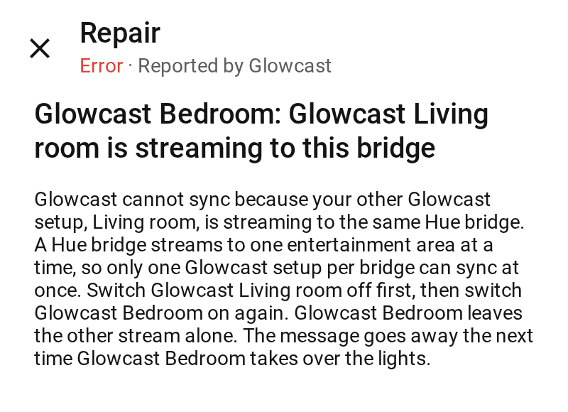

# Glowcast v0.5.1

Small fixes after v0.5: when two Glowcast setups share a Hue bridge, the message says which one is streaming, and the website has a new Light research section. Still an early version.

## What changed

- **The busy message names your other Glowcast.** A Hue bridge streams to one entertainment area at a time. With two Glowcast setups on one bridge (two TVs, for example), the one you switch on while the other streams still stops, as before. Now Home Assistant also shows a repair that names the one that streams, for example "Glowcast Bedroom: Glowcast Living room is streaming to this bridge", and the log names it too (#299). Switch that one off first; the repair goes away the next time this Glowcast takes over the lights. The status stays as it was (**Error**, stop reason `output_busy`), so your automations keep working. When another app streams (the Hue Sync app, a Sync Box), nothing changes. See [Another app is streaming](https://nicohabets.github.io/glowcast/guide/problems/#another-app-is-streaming).

  

  *The repair when your other Glowcast streams to the same bridge.*

- **Light research on the website.** A new section, [Light research](https://nicohabets.github.io/glowcast/research/), answers the questions behind Glowcast's choices: colours and fades, where each light looks, dark pictures, lights and bridges, and speed and hardware. Each answer has the key numbers, what Glowcast does since, and the room and bench pictures and charts from the measurements (#309, #318).
- **How Glowcast is tested**, on the website, now shows the room for v0.5.0 and v0.5.1 too (the same as v0.4.0 in every scenario), and a new scenario: a Home Assistant light that is also in the entertainment area (#301). See [How Glowcast is tested](https://nicohabets.github.io/glowcast/testing/).

## For contributors

Nothing else changes for you as a user.

- **An output type can name the cause of a stop**: `OutputType.stop_details` adds a repair issue to some of the stops with one reason, with placeholders from a check of the entry's data; the runtime raises it, logs it and clears it at the next successful start. The Hue output uses it for the busy bridge (#299). The demo's fake bridge gives each pairing its own key and application id.
- **The test bench's checks are steadier** (#231): the white, the glow on black and the Test lights checks no longer flip between pass and fail while the lights show the same thing, and still fail on a light that shows the wrong thing. The tolerances are in `scripts/README.md`.
- **The room** has an in-area scenario (`room --lights in-area`): the floor lamp is a Home Assistant light and in the entertainment area at once, on a fake bridge that answers through Home Assistant's session (#301). The testing pages show it for every release since v0.3.0.

## Upgrading from v0.5.0

Update Glowcast in HACS (or under Settings → System → Updates) and restart Home Assistant. Your settings stay as they are, the entities keep their entity ids, and there are no new entities. The blueprints are unchanged.

Coming from v0.4.0 or older? Read [Upgrading from v0.4.0](v0.5.0.md#upgrading-from-v040) first: Glowcast needs **Home Assistant 2026.8.3 or newer** since v0.5.0.

## Known limits

- **webOS 26:** Home Assistant 2026.8.3 is the minimum that can work, not a guarantee; a few TVs are reported to still refuse to pair. Glowcast has not been tried on a TV with webOS 26 yet.
- **The screenshot call is untested on webOS 26 and on older webOS TVs.** Tried it? Please run the hardware check and [open a hardware report](https://github.com/nicohabets/glowcast/issues/new?template=hardware-report.md).
- **Next to a Hue Sync Box**, the notice for a light in an area another app syncs is checked only when Glowcast starts (#272).
- **HDR and Dolby Vision** have not been checked yet (#160).
- **One stream per bridge at a time**, so two TVs on one bridge cannot sync together; a repair names your other Glowcast that streams (see above).
- The other limits still apply (about 3 captures per second; LG webOS TVs only for now, tested on one model, with a computer screen as a preview), see [Known limits](https://nicohabets.github.io/glowcast/docs/limits/) on the website.

## Requirements and installation

As for v0.5.0: Home Assistant 2026.8.3 or newer and an LG webOS TV set up in Home Assistant. For the lights, a Hue Bridge v2 or Bridge Pro with an entertainment area, colour lights in Home Assistant (Home Assistant lights), or both together. See [Installation](https://nicohabets.github.io/glowcast/docs/installation/) on the website.
