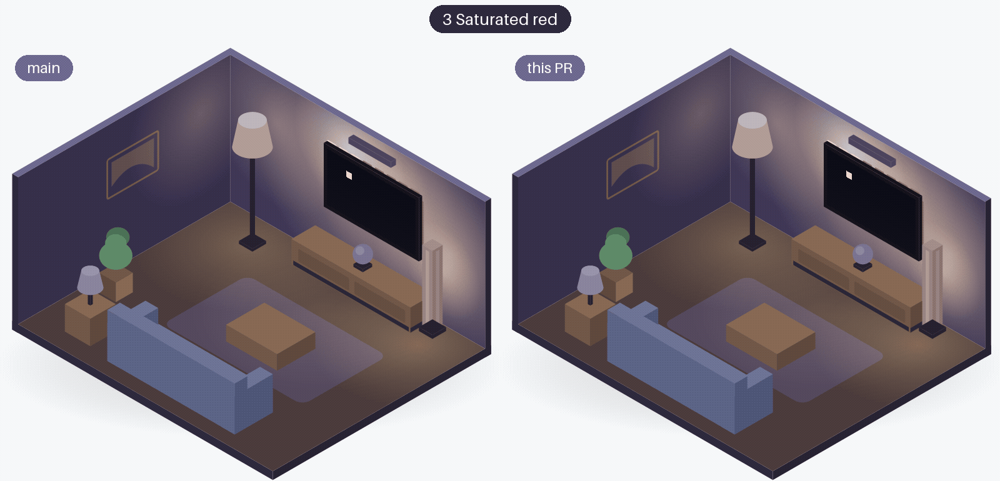
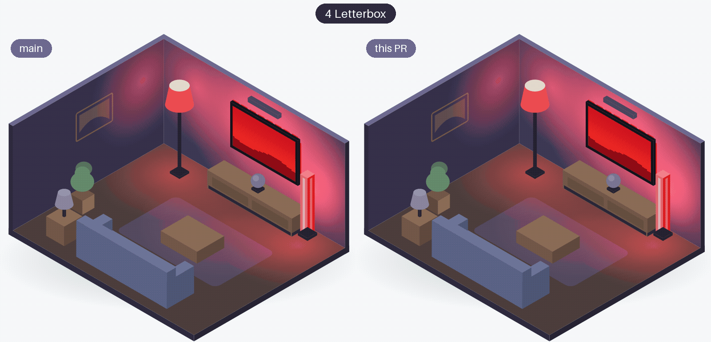
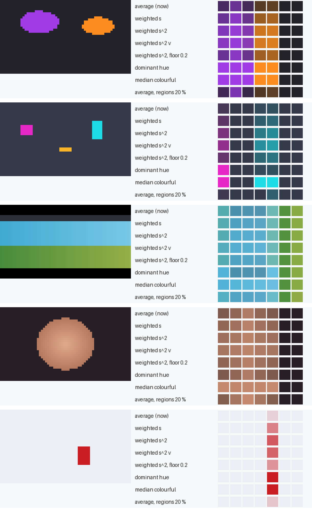
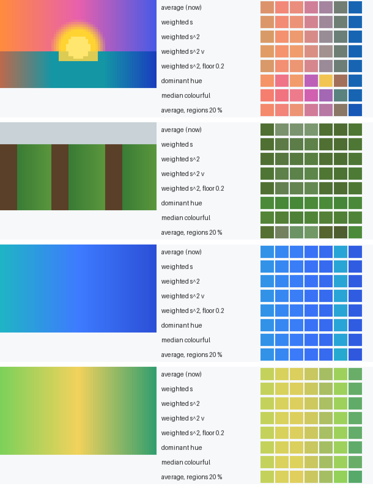
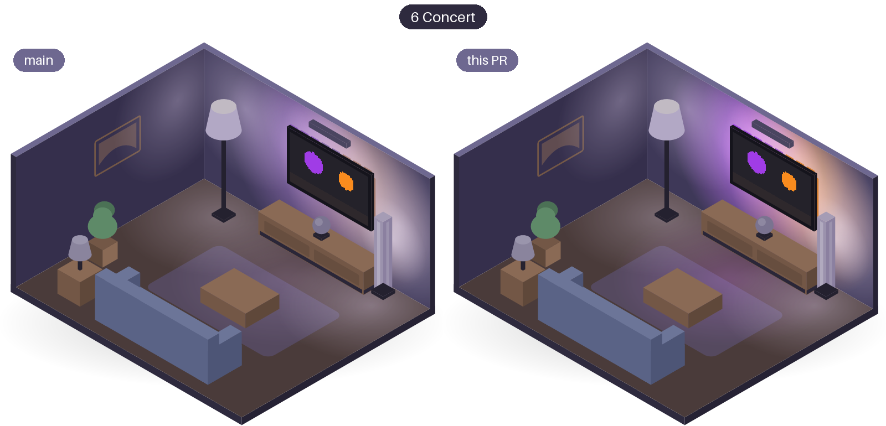
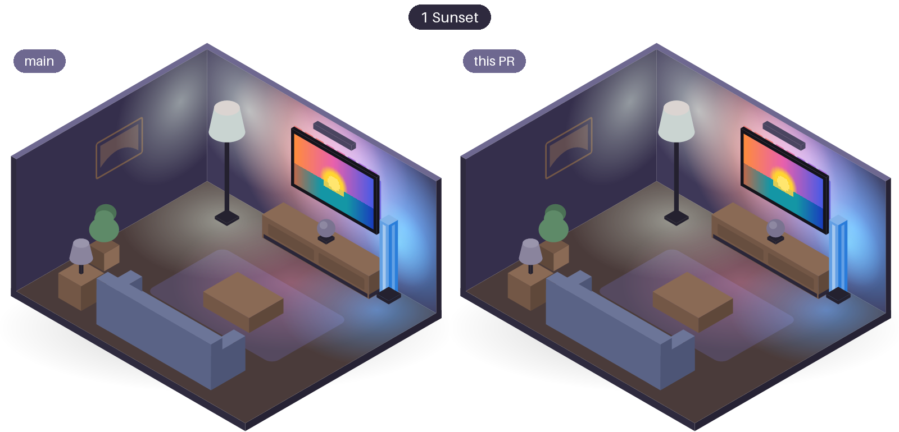
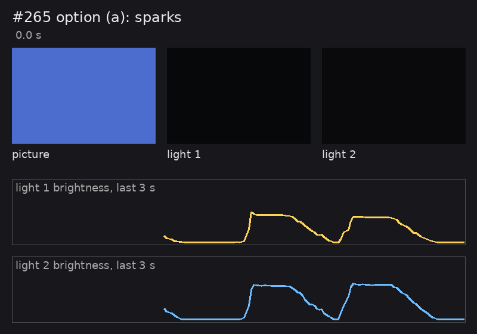
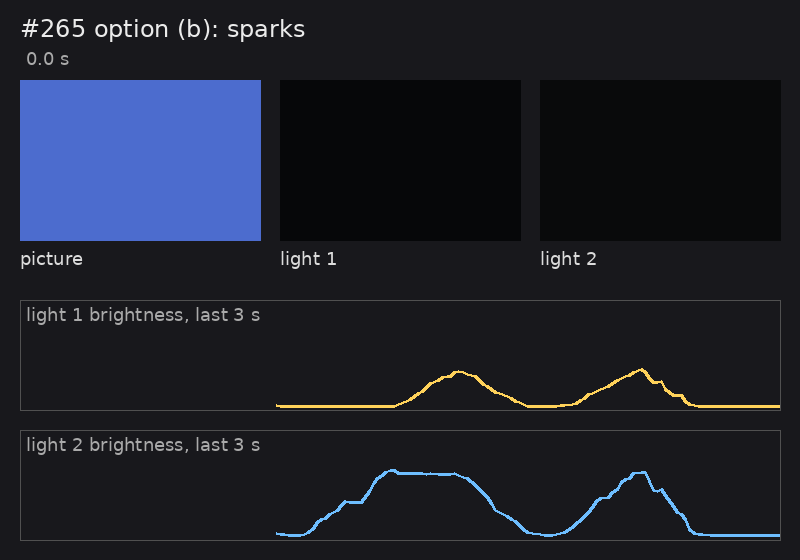
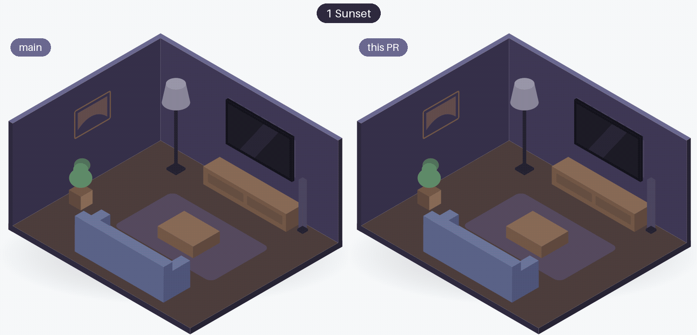

# Colours and fades

Which colour a light gets from its part of the picture, and how it moves from one colour to the next.
Each section below is one research question: what was measured, what was chosen, and the room or the test bench before and after.

## Fades on scene cuts { #fades-on-scene-cuts }

**The question:** which fade makes scene cuts feel immediate and small changes soft, at the TV's capture rate?

**The answer:** a short fade of 80 ms when a colour jumps a lot (a cut), and the slow linear fade over the capture interval for everything else.

| Measured | Before (linear fade) | After (cut fade) |
|---|---|---|
| Simulation at 3 captures per second: halfway after a cut | 213 ms | 53 ms |
| Simulation: 90 % after a cut | 493 ms | 93 ms |
| Simulation: ripple on a slow drift (1 = even) | 1.19 | 1.19 |
| Room: halfway after the cut to a saturated red | 0.68 s | 0.56 s |
| Test bench, screen mode: picture to light, median / p90 | 423-464 / 573-653 ms | 336 / 515 ms |
| Test bench, pattern mode: picture to light, median / p90 | 417-485 / 592-664 ms | 350 / 414 ms |

The spike also tried ease-out curves (quadratic and cubic). They were faster everywhere, but made slow drifts pulse with every capture (ripple 1.93 and 2.67), so they were not chosen.

**What Glowcast does since:** v0.4.0. When one colour component of a light jumps by more than 0.25, that light fades to the new colour in 80 ms; smaller changes fade over the time between two captures, as before. A fade to black is never a cut, so the glow after a dark scene still comes softly. This is Liveliness Normal, the default; Calm has no fast cut, and Lively takes a jump of 0.18 as a cut and fades it in 40 ms.

| A cut to a saturated red | A cut to a film with black bars |
|---|---|
| [{ width="400" loading=lazy }](cut-red-room.gif) | [{ width="400" loading=lazy }](cut-letterbox-room.gif) |

*The room, left before the change and right with it: the lights on the right reach the new colour about 120 ms sooner.*

**More:** [spike #35 and its result](https://github.com/nicohabets/glowcast/issues/35#issuecomment-6535120607), [story #258](https://github.com/nicohabets/glowcast/issues/258), [pull request #259](https://github.com/nicohabets/glowcast/pull/259), [website pull request #291](https://github.com/nicohabets/glowcast/pull/291)

## Livelier colours { #livelier-colours }

**The question:** which way of choosing a colour per region gives livelier colours than the region's average, without flicker?

**The answer:** an average in which colourful, bright pixels count most; the dominant colour and the median flicker.

The spike compared seven methods on pictures made in code (a stage with spotlights, a neon city at night, a face, snow with a red jacket, a forest, and the room's scenes):

| Method (spike) | Mean saturation | Largest jump between noisy frames (0-255) | ms per frame, 16 lights |
|---|---|---|---|
| plain average (before) | 0.43 | 4 | 0.34 |
| weighted by saturation² × brightness (the spike's first choice) | 0.49 | 5 | 1.02 |
| dominant hue | 0.51 | 90 | 1.54 |
| median of the colourful pixels | 0.52 | 196 | 0.81 |
| smaller regions (20 % instead of 30 %) | 0.45 | 5 | 0.18 |

While building it, the weight was tuned once more to `(0.5 + s²) × v`, so a small coloured object only tints a white scene. With the weight that shipped:

| Measured | Plain average | Weight that shipped |
|---|---|---|
| Stage with spotlights: saturation / brightness | 0.46 / 0.33 | 0.59 / 0.62 |
| White with a small red object: saturation (spike's first weight: 0.48) | - | 0.14 |
| Time for 16 lights on the bench laptop, median | 0.23 ms | 0.55 ms |

**What Glowcast does since:** v0.4.0. Each lit pixel counts with `(0.5 + s²) × v`, where `s` is its saturation and `v` its brightness. A region that mixes a colourful object with a dark background shows the object's colour; smooth pictures stay about as they were. This is Liveliness Normal, the default; Calm and Lively use a different floor for the weight.

| The spike's mixed scenes | The spike's smooth scenes |
|---|---|
| [{ width="400" loading=lazy }](livelier-swatches-mixed.png) | [{ width="400" loading=lazy }](livelier-swatches-smooth.png) |

*Still images from the spike: each picture, then one row of the room's seven light colours per method. "weighted s^2 v" is the spike's first choice, not the weight that shipped. On the mixed scenes the weighted rows are clearly more colourful; on the smooth scenes all rows look alike.*

| A concert on a dark stage | A sunset |
|---|---|
| [{ width="400" loading=lazy }](livelier-concert-room.png) | [{ width="400" loading=lazy }](livelier-sunset-room.png) |

*The room, left before the change and right with it (stills). At the concert the lights turn from a pale lilac-grey to purple on the left and orange on the right; the sunset, a smooth picture, barely changes.*

**More:** [spike #40 and its result](https://github.com/nicohabets/glowcast/issues/40#issuecomment-6533296573), [story #233](https://github.com/nicohabets/glowcast/issues/233), [pull request #250](https://github.com/nicohabets/glowcast/pull/250)

## Busy content and the cut fade { #busy-content }

**The question:** since the cut fade, should a jump up from black also count as a cut, now that sparkly pictures make a light snap up fast and fade down slowly?

**The answer:** no, keep it as it is: real-looking busy content barely shows the effect, and the alternative makes every scene after black about 0.28 s slower.

Measured on the test bench, screen mode at update rate High (the TV's pace), the camera at 54 frames per second, two lights:

| Scene | Measured | (a) as it is | (b) no cut up from black |
|---|---|---|---|
| sparks (built to cause it) | rise, 10 to 90 %, median | 64-88 ms | 208-224 ms |
| sparks | fall, 90 to 10 %, median | 224-239 ms | 224 ms |
| sparks | swings per second | 0.83-0.92 | 0.92 |
| fireworks | swings per second | 0.42 | 0.42-0.58 |
| starfield | swing | under 1 (the glow throughout) | under 1 |
| after black | picture to light halfway, median | 408 ms | about 690 ms |

**What Glowcast does since:** unchanged since v0.4.0 (option (a), the product owner's choice on 31-10-2026). The lights may flash up quickly and fade down a little slower on sparks or confetti on black; a check of busy content on the TV is still to come.

| (a) as it is | (b) no cut up from black |
|---|---|
| [{ width="400" loading=lazy }](p265-sparks-a.gif) | [{ width="400" loading=lazy }](p265-sparks-b.gif) |

*Six seconds of the sparks on the test bench, drawn from the camera's measured colours of the monitor and the two lights, with each light's brightness over the last 3 s: a sawtooth with (a), a symmetric swing with (b).*

**More:** [issue #265 and the bench result](https://github.com/nicohabets/glowcast/issues/265#issuecomment-6541769084), [the cut fade, pull request #259](https://github.com/nicohabets/glowcast/pull/259)

## The fade-in when Glowcast takes the lights { #fade-in }

**The question:** how can the lights change calmly when Glowcast takes them over, instead of jumping to the picture's colours?

**The answer:** fade in over about 2 s from each light's own colour and brightness, because the bridge keeps the lights as they were until the first colour arrives.

| Measured on the test bench | Value |
|---|---|
| Area active after the switch-on | 0.55-0.77 s |
| First colour after the switch-on | 3.45-3.57 s |
| The light in between (its own state) | within 4-11 % of its level before the start |
| Before: the jump to the first colour | within 0.03 s |
| With the fade-in: from the light's own state to the picture | 1.5-1.65 s |
| Brightness at the very start, against the light's own | 0.60-0.63 |
| Streamed full white, against the light's own full white | about 70 % |

The small dip at the start cannot be avoided: no colour sent in the entertainment stream reaches a light's own full white.

**What Glowcast does since:** v0.3.0. When Glowcast takes the lights, they fade in over about 2 s from how they were: a lamp in warm white goes from warm white to the picture, a light that was off fades up from dark. The same when the picture comes back after a moment without one. A settings change or a reconnect does not fade in again.

[{ width="400" loading=lazy }](fade-in-room.gif)

*The room at the switch-on, left before the change and right with it: the lights on the right fade in to the sunset's colours over about 2 s. The room's lights have no own state, so they fade in from dark.*

**More:** [story #153 and the bench check](https://github.com/nicohabets/glowcast/issues/153), [pull request #188](https://github.com/nicohabets/glowcast/pull/188)
