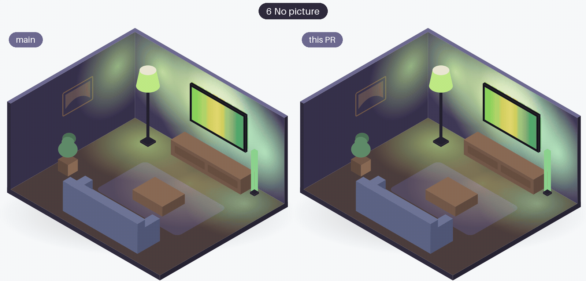
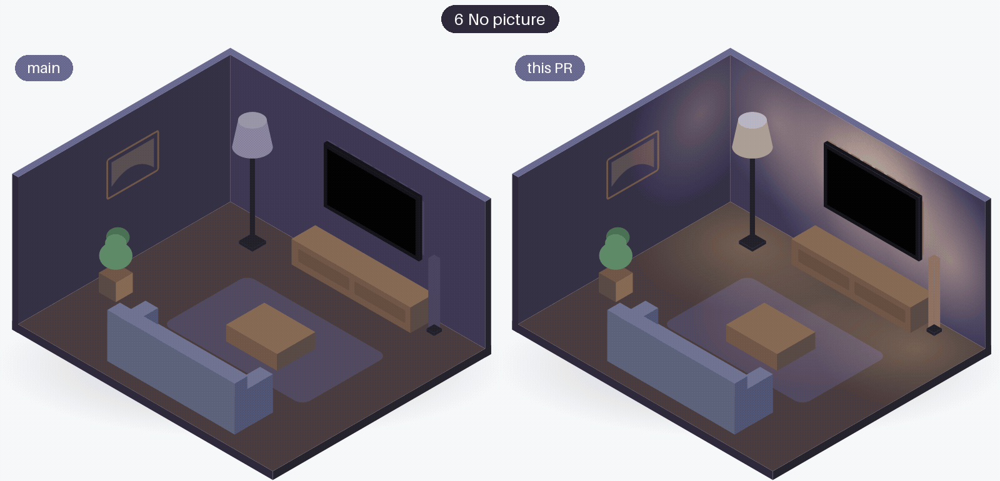

# Dark pictures and no picture

What the TV gives when the picture is dark, black or missing, and what the lights do then.
Each section is one research question, measured on the test TV (a 2023 LG G3) or the test bench.

## Streaming apps with DRM { #drm-apps }

**The question:** what does the TV's screen capture return while a protected streaming app plays?

**The answer:** a protected app in the TV's own apps gives completely black captures; the same service on a streaming device over HDMI gives the real picture.

| What was tested | Result |
|---|---|
| Prime Video in the TV's own app | every capture all zero (every pixel 0) |
| Captures per second in that app | about 6.9 (the black JPEG is tiny) |
| Prime Video on a streaming device over HDMI | the real picture |
| Letterbox bars in that film | pure black, 0-7 of 255 |
| Release after a Prime Video film started (v0.2.0) | about 14 s: the app's start screen (a logo on black) is not all zero |

Not tested: Netflix, Disney+ and YouTube in the TV's own apps, and an Apple TV or Chromecast over HDMI. Those are left to hardware reports.

**What Glowcast does since:** v0.1.0 lists it as a known limit (the lights showed only the faint glow). Since v0.2.0 Glowcast lets go of the lights after 7 s of an all-zero picture, about 8 s with the release, and follows again when the picture returns (see the next section).

**More:** [spike #8](https://github.com/nicohabets/glowcast/issues/8), [story #5](https://github.com/nicohabets/glowcast/issues/5) and its pull request [#36](https://github.com/nicohabets/glowcast/pull/36).

## All-zero frames in films and series, and the 7 s wait { #all-zero-frames }

**The question:** do films and series give all-zero frames, and is a 3 s wait before releasing the lights long enough?

**The answer:** no; a streaming device over HDMI gave all-zero runs of 3-5 s four times in an hour, so the wait became 7 s.

The first measurement (#68) was 55 minutes of a game console over HDMI: no all-zero frame during play, only single frames at a hard cut and an input switch, and 4-6 s while an HDMI picture dropped. That gave a first wait of 3 s, which never shipped in a release. The second measurement (#126) was an hour of a film or series over HDMI.

| | Game console (#68) | Film or series (#126) |
|---|---|---|
| Measured | 54.8 min, 3286 frames | 60.0 min, 3592 frames |
| Captures per second (extra connection) | 1 | 1 |
| All-zero runs | 3 (at transitions) | 10 (in normal viewing) |
| Longest run | 4-6 s (an HDMI picture dropping) | 3.0-5.0 s (four times) |
| Runs that released the lights with the 3 s wait | - | 4, each for 1.4-3.8 s plus the Hue handshake |
| Darkest frame that was not all zero | maximum 100 during play | maximum 53 |

- The runs in the film came after a hard cut or an almost black frame, never after a fade.
- A dark scene is never all zero here, so "dark" and "no picture" stay clearly apart.
- 7 s covers the longest run seen (at most 5 s) with 2 s of margin. The cost: a protected app releases the lights after about 8 s instead of about 4 s.
- Not measured: live TV, the TV's own apps and other HDMI devices.

**What Glowcast does since:** v0.2.0. After 7 s of all-zero frames Glowcast lets go of the lights, so they return to how they were; the switch stays on and the next real picture claims them again. During the wait the hold on black keeps the last colours for 3.5 s, then the faint glow shows until the release.

| The room, 3 s wait (left) and 7 s wait (right) | 5.5 s into no picture |
|---|---|
| [{ width="400" loading=lazy }](no-picture-wait-7s-room.gif) | [{ width="400" loading=lazy }](no-picture-wait-7s-at-5-5s.png) |
| Left: the 3 s wait (before #139, never in a release). Right: the 7 s wait (since v0.2.0). | At 5.5 s the 3 s wait has released the lights; the 7 s wait still shows the glow. |

**More:** [spike #126](https://github.com/nicohabets/glowcast/issues/126), [story #139](https://github.com/nicohabets/glowcast/issues/139) and its pull request [#157](https://github.com/nicohabets/glowcast/pull/157); the first measurement and the release in [story #68](https://github.com/nicohabets/glowcast/issues/68) and pull request [#123](https://github.com/nicohabets/glowcast/pull/123).

## Black before the TV turns off { #black-before-off }

**The question:** how long is the picture black before the TV reports that it is off, so the lights can skip the glow at a switch-off?

**The answer:** the TV shows an almost black switch-off animation for 2.7-3.0 s before it reports off, so Glowcast holds the last colours for 3.5 s on a sudden black picture.

| Measurement | Result |
|---|---|
| Switch-off animation | almost black, 1-2 % of the pixels lit, some nearly white |
| Black before the TV reports off (4 tries) | 2.99, 2.84, 2.87, 2.72 s |
| Last frame with a picture before off | 2.96-3.24 s |
| First attempt (every region black) | 0.32-0.63 s: the animation's bright element kept one region lit |
| From the stop to the bridge restoring the lights | about 1.2 s |

The fix decides "black" over the whole frame: fewer than 5 % of the pixels above the black level.

**What Glowcast does since:** v0.1.0. On a sudden black picture the lights keep the last colours for 3.5 s, half a second above the longest measured animation. At a switch-off they go straight from the picture's colours back to how they were; a real black scene reaches the glow after about 3.5 s.

**More:** [story #39](https://github.com/nicohabets/glowcast/issues/39) and its pull request [#42](https://github.com/nicohabets/glowcast/pull/42).

## When syncing stops { #when-syncing-stops }

**The question:** why did lights stay on the last streamed colour after a stop on one entertainment area, while on others they came back?

**The answer:** it is the area's "When syncing stops" setting in the Hue app; the bridge applies it to Glowcast's stream too, and only looking at the lights shows it.

| Setting | Runs | Lights back to how they were |
|---|---|---|
| Pause on the last colour | 6 here, 2 in #133 | no, in every run (watched 30-40 s) |
| Last on-state | 2 | yes, 1.7 s after `stop()` returned |

- With "Pause" the lights stayed whatever the last colour, with or without a pause before the stop, in either stop order, and when the bridge's own idle timeout ended the stream (5-10 s after the last packet).
- The setting is not in the bridge's API, and after the stream the bridge and Home Assistant report the lights' state from before it either way.
- Glowcast's own switch-off on the test bench, with "Last on-state": area inactive after 1.24 s, lights back after 2.3-2.6 s (camera).
- Only "Pause on the last colour" and "Last on-state" were tested; the app also offers "Off" and some scenes.

**What Glowcast does since:** no change to the stop; Glowcast relies on the area's setting. Since v0.2.0 the known limits explain it, and Home Assistant lights (since v0.3.0) always go back to how they were.

**More:** [spike #142](https://github.com/nicohabets/glowcast/issues/142) and its pull request [#148](https://github.com/nicohabets/glowcast/pull/148).
