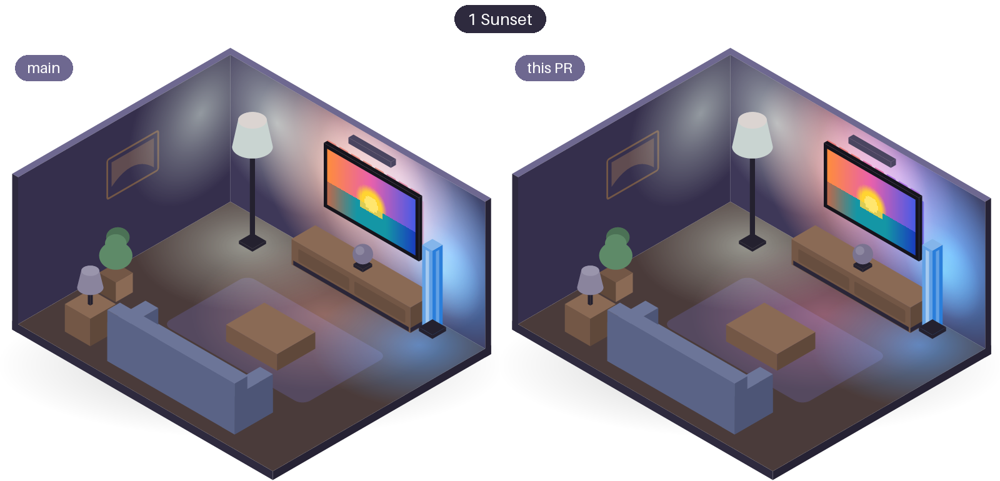
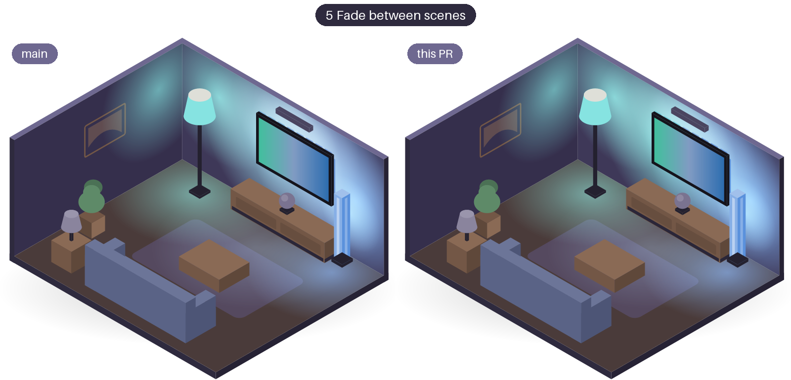
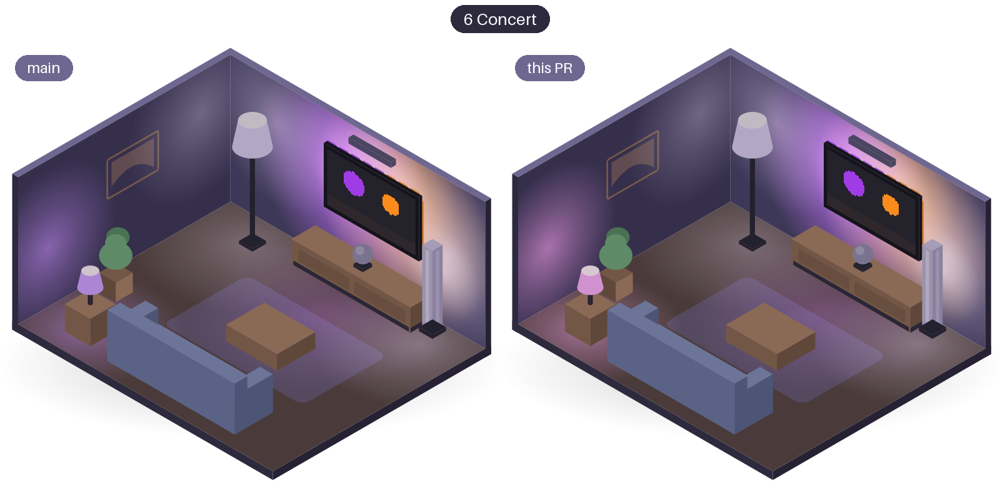
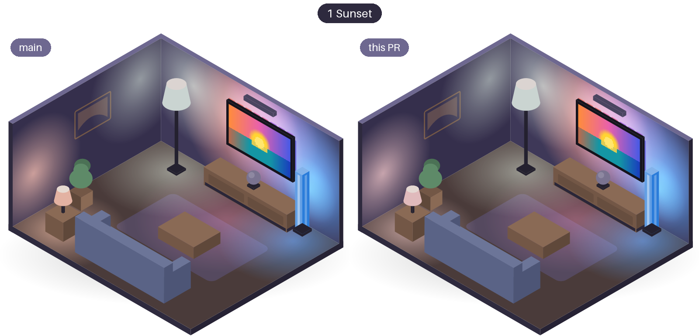
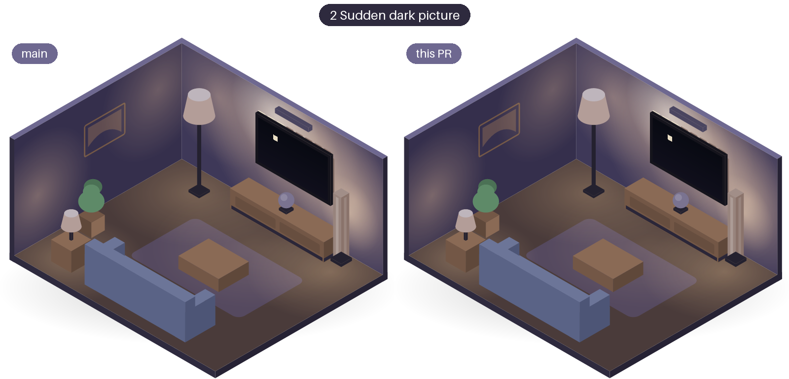
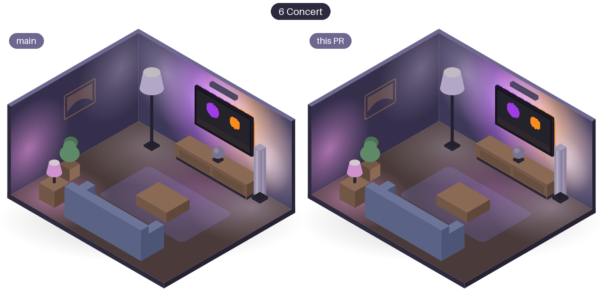
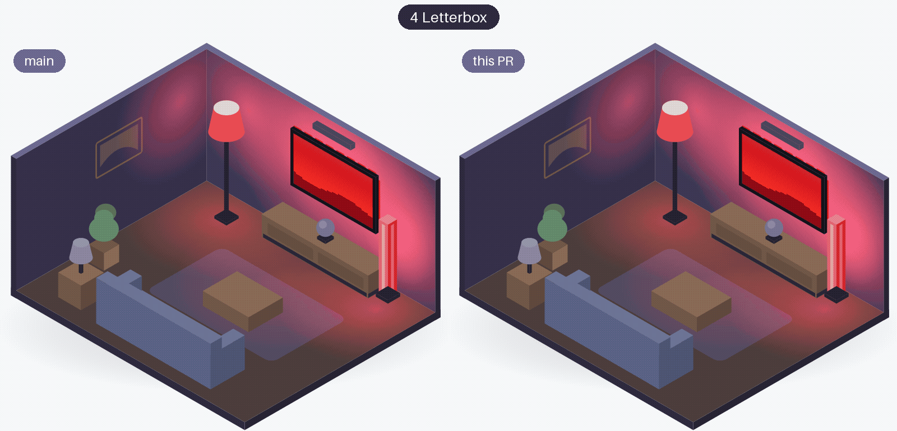
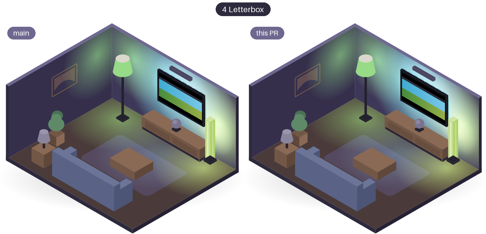
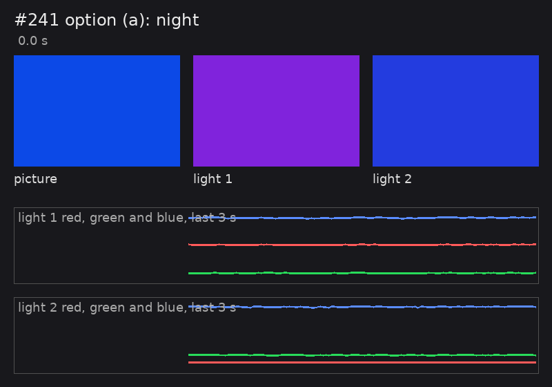
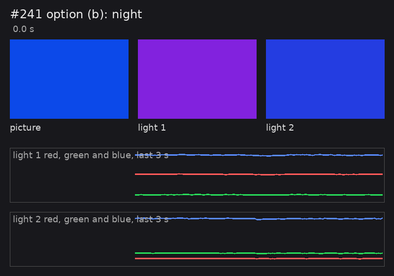

# Where each light looks

Every light takes its colour from one part of the picture, chosen by its place in the Hue entertainment area.
Each section below is one research question about that mapping: what was measured, what was chosen, and the room or the test bench before and after.

## TV strips reach the edges of the picture { #tv-strips-reach-the-edges }

**The question:** how can a gradient lightstrip behind the TV show the colours at the very edges of the picture?

**The answer:** stretch a light around the screen from the centre until its outermost segments reach the picture's edges; leave every other light where it is.

| Measured | Value |
|---|---|
| TV strip's segments in the test area, left-right and up-down | between -0.4 and 0.4 (the edges are -1 and +1) |
| Where they sampled before | about 30 % in from the edges |
| A light counts as near the TV from depth | 0.5 (+1 is the TV side) |
| An axis is left alone when all segments sit within | 0.1 of the centre |
| Colour engine, 16 lights, median, before and after | 0.23 ms and 0.23 ms |

**What Glowcast does since:** v0.4.0. A gradient light with several segments, all on the TV side and some left and some right of the centre, is stretched to the edges of the picture: its left and right segments show the picture's left and right edges, its top segments the top edge. Single lamps, Home Assistant lights and gradient lights elsewhere in the room keep their place. Since the fixes in #239, this is decided for the whole light, never per segment.

| A sunset | A fade between scenes |
|---|---|
| [{ width="400" loading=lazy }](strip-sunset-room.png) | [{ width="400" loading=lazy }](strip-fade-room.png) |

*The room, left before the change and right with it (stills). Before, the whole strip took the middle of the picture (pink in the sunset); now its left segment takes the left edge (orange) and its right segment the right edge (blue).*

**More:** [story #23](https://github.com/nicohabets/glowcast/issues/23), [pull request #229](https://github.com/nicohabets/glowcast/pull/229), [fixes #239](https://github.com/nicohabets/glowcast/issues/239) and [pull request #248](https://github.com/nicohabets/glowcast/pull/248)

## Lights far from the TV follow more softly { #far-lights }

**The question:** how can lights behind the couch follow the picture more softly than lights next to the TV?

**The answer:** blend a far light's colour with the colour of the whole picture, more the further it is from the TV, and dim that blend when most of the picture is dark.

| Measured | Value |
|---|---|
| Share of the whole picture at depth 0.5 or nearer the TV | 0 |
| In the middle of the room (depth 0) | about 17 % |
| At the back wall (depth -1) | 50 % |
| Colour engine, 16 lights, median, without and with far lights | 0.53 ms and 0.89-0.90 ms |
| Far light in a dark picture with a small bright object, before the fix in #262 | (0.46, 0.37, 0.22), brighter than the lights at the TV |
| The same after #262 | about 0.03 |

**What Glowcast does since:** v0.4.0. A light further from the TV in the Hue app blends its own part of the picture with the whole picture: not at all near the TV, up to half at the back wall. The whole picture is scaled by how much of it is lit, so in a dark scene the lamps at the back stay dim. Home Assistant lights have no depth and are not blended. Half at the back wall is Liveliness Normal, the default; Calm blends more and Lively less.

| A concert on a dark stage | A sunset |
|---|---|
| [{ width="400" loading=lazy }](far-concert-room.png) | [{ width="400" loading=lazy }](far-sunset-room.png) |

*The room, left before #15 and right with it (stills). The table lamp by the sofa is the far light: at the concert it no longer takes the purple spotlight on its side but a softer mauve of the whole picture; at the sunset the step is smaller.*

| A sudden dark picture | A concert |
|---|---|
| [{ width="400" loading=lazy }](far-dark-picture-room.png) | [{ width="400" loading=lazy }](far-dark-concert-room.png) |

*The room, left before the fix in #262 and right with it (stills). In the dark picture the table lamp stays dim instead of taking half of the moon's colour; at the concert, a lit picture, it blends almost as before.*

**More:** [story #15](https://github.com/nicohabets/glowcast/issues/15), [pull request #256](https://github.com/nicohabets/glowcast/pull/256), [fix #262](https://github.com/nicohabets/glowcast/issues/262) and [pull request #267](https://github.com/nicohabets/glowcast/pull/267)

## Letterbox bars { #letterbox-bars }

**The question:** how do the top and bottom lights avoid turning grey on films with black bars?

**The answer:** find the bars and map every light onto the picture inside them, after the bars have stayed the same for 2 s.

| Measured | Value |
|---|---|
| Bars in a film on the TV (over HDMI) | pure black, 0-7 of 255; 5 rows at the top and 3 at the bottom of 36, later 1 and 2 |
| A new bar width is taken after | 2 s |
| A row or column is bar when lit at most | 5 % |
| Largest bar per side | 25 % of the frame (more is a dark scene) |
| A pending width is forgotten after | 1.5 s without it |
| Room, letterbox film at dusk: top segment of the strip, before and after | (68, 115, 139) and (74, 133, 159) |
| Colour engine, 16 lights, median, before and after | 0.23 ms and 0.24 ms, plus 0.05-0.08 ms for the bars |

**What Glowcast does since:** v0.4.0. Glowcast measures black bars above and below the picture, or beside it, on every frame, and follows a new width after it has stayed for 2 s. Subtitles in the bottom bar count as bar, and a fade to black keeps the bars. Since the fixes in #239, a narrower bar is always taken, so no row of the picture is cut off.

| The letterbox film at dusk | The same, after 2 s |
|---|---|
| [{ width="400" loading=lazy }](letterbox-room.gif) | [{ width="400" loading=lazy }](letterbox-room.png) |

*The room, left before the change and right with it. After 2 s the top of the strip on the right takes the sky inside the bars instead of the bar plus a dim band.*

**More:** [story #34](https://github.com/nicohabets/glowcast/issues/34), [pull request #226](https://github.com/nicohabets/glowcast/pull/226), [fixes #239](https://github.com/nicohabets/glowcast/issues/239) and [pull request #248](https://github.com/nicohabets/glowcast/pull/248)

## Dark bands near an edge counted as bars { #dark-bands }

**The question:** should a long dark band near an edge (a night sky, a vignette, a dark menu bar) be kept from counting as a black bar?

**The answer:** the effect is there but mild, and the alternative only delays it while delaying real bars too. The product owner has not chosen yet; the recommendation is to keep it.

Measured on the test bench, screen mode at update rate High (the TV's pace), each scene 10 s, twice:

| Scene | Bars taken (rows of 36) | (a) as it is: taken after | (b) wider bars after 5 s: taken after | Colour change of the nearest light (0-255) |
|---|---|---|---|---|
| night sky (dark top 10 %) | top 3 | 2.7-2.9 s | 5.6-5.8 s | 10-12 |
| vignette | 6 on every side | 2.5-2.7 s | 5.6-5.8 s | 22-25 |
| dark menu bar (top 4 %) | none | - | - | under 1.5 |
| film with real bars (2.39:1) | top 4, bottom 4 | 2.6-2.8 s | 5.6-5.7 s | 6-7 |

With (a) the bars are released 2.5-2.8 s after the scene, with (b) after about 1 s. Left and right stayed even.

**What Glowcast does since:** unchanged since v0.4.0. A dark band near an edge that lasts longer than about 2 s counts as a bar, so the lights take their colours a little further into the picture until the band goes.

| (a) as it is | (b) wider bars after 5 s |
|---|---|
| [{ width="400" loading=lazy }](p241-night-a.gif) | [{ width="400" loading=lazy }](p241-night-b.gif) |

*Seven seconds of the night sky on the test bench, drawn from the camera's measured colours of the monitor and the two lights, with each light's red, green and blue over the last 3 s and the moment Glowcast takes the top bar.*

**More:** [issue #241 and the bench result](https://github.com/nicohabets/glowcast/issues/241#issuecomment-6541840621), [letterbox bars, pull request #226](https://github.com/nicohabets/glowcast/pull/226)
