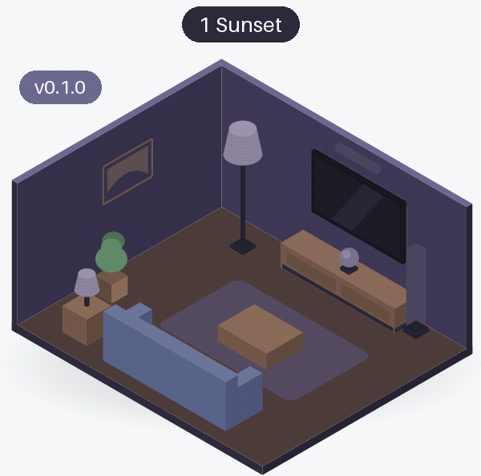
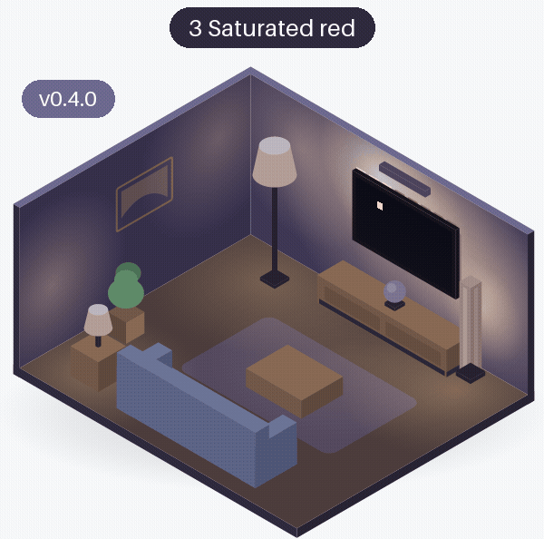
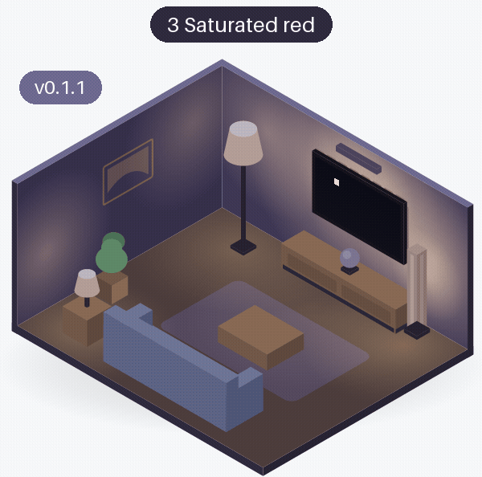
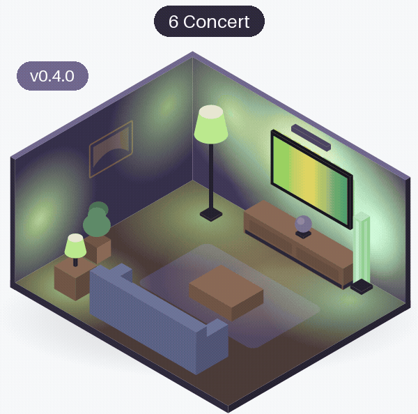

# Colours

How the lights take the colours of the picture: a warm sunset, a pure saturated colour, and colourful spots on a dark stage. Each room is drawn from that release's own code (see [the room](index.md#the-room)); a scenario starts with the lights as the scenario before it left them.

<!-- rooms -->
| Scenario | v0.4.0 | v0.3.1 | v0.3.0 | v0.2.0 | v0.1.1 | v0.1.0 |
|---|---|---|---|---|---|---|
| [1 Sunset](#area-sunset) | [{ width="140" loading=lazy }](rooms/v0.4.0/area-sunset.gif) [● changed](#area-sunset){ .glowcast-changed } | [same](rooms/v0.3.0/area-sunset.gif "same as v0.3.0") | [{ width="140" loading=lazy }](rooms/v0.3.0/area-sunset.gif) [● changed](#area-sunset){ .glowcast-changed } | [same](rooms/v0.1.1/area-sunset.gif "same as v0.1.1") | [{ width="140" loading=lazy }](rooms/v0.1.1/area-sunset.gif) [● changed](#area-sunset){ .glowcast-changed } | [{ width="140" loading=lazy }](rooms/v0.1.0/area-sunset.gif) [new](#area-sunset) |
| [3 Saturated red](#area-saturated-red) | [{ width="140" loading=lazy }](rooms/v0.4.0/area-saturated-red.gif) [● changed](#area-saturated-red){ .glowcast-changed } | [same](rooms/v0.1.1/area-saturated-red.gif "same as v0.1.1") | [same](rooms/v0.1.1/area-saturated-red.gif "same as v0.1.1") | [same](rooms/v0.1.1/area-saturated-red.gif "same as v0.1.1") | [{ width="140" loading=lazy }](rooms/v0.1.1/area-saturated-red.gif) [● changed](#area-saturated-red){ .glowcast-changed } | [{ width="140" loading=lazy }](rooms/v0.1.0/area-saturated-red.gif) [new](#area-saturated-red) |
| [6 Concert](#area-concert) | [{ width="140" loading=lazy }](rooms/v0.4.0/area-concert.gif) [● changed](#area-concert){ .glowcast-changed } | [same](rooms/v0.1.0/area-concert.gif "same as v0.1.0") | [same](rooms/v0.1.0/area-concert.gif "same as v0.1.0") | [same](rooms/v0.1.0/area-concert.gif "same as v0.1.0") | [same](rooms/v0.1.0/area-concert.gif "same as v0.1.0") | [{ width="140" loading=lazy }](rooms/v0.1.0/area-concert.gif) [new](#area-concert) |

● changed: what the lights get changed since the previous release; new: the first release with these lights. Both show the GIF; click it to see it full size. same: the same as in the previous release (within rounding), a link to its GIF. -: not available.

### 1 Sunset { #area-sunset }

**The picture:** A sunset: an orange and pink sky with the sun low over a blue-green sea, the start of the run. Before it the lights are as they were.

**What the lights should do:** Take the picture's colours, each light the colour of its own part of the picture: warm from the sky, blue-green from the sea.

=== "v0.4.0 ●"

    ● Livelier colours, the lightstrip follows the edges of the picture, and the table lamp at the back of the room follows more softly.

    [{ width="400" loading=lazy }](rooms/v0.4.0/area-sunset.gif)

=== "v0.3.1"

    Same as v0.3.0. v0.3.1 changed what the room does not show; see [the overview](index.md#same-room-other-changes).

    [{ width="400" loading=lazy }](rooms/v0.3.0/area-sunset.gif)

=== "v0.3.0 ●"

    ● A calm start: the lights fade in from how they were, in about 2 seconds.

    [{ width="400" loading=lazy }](rooms/v0.3.0/area-sunset.gif)

=== "v0.2.0"

    Same as v0.1.1.

    [{ width="400" loading=lazy }](rooms/v0.1.1/area-sunset.gif)

=== "v0.1.1 ●"

    ● Saturated colours stay pure: the warm glow is only added to lights that show a dark part of the picture.

    [{ width="400" loading=lazy }](rooms/v0.1.1/area-sunset.gif)

=== "v0.1.0"

    The first release.

    [{ width="400" loading=lazy }](rooms/v0.1.0/area-sunset.gif)

### 3 Saturated red { #area-saturated-red }

**The picture:** A cut from the dark picture before it to a deep, saturated red over the whole screen.

**What the lights should do:** Follow the cut quickly and show a pure red, without white or a warm glow mixed in.

=== "v0.4.0 ●"

    ● The cut shows at once (a big jump fades in 80 milliseconds), and the strip's sides show the picture's edges.

    [{ width="400" loading=lazy }](rooms/v0.4.0/area-saturated-red.gif)

=== "v0.3.1"

    Same as v0.1.1. v0.3.1 changed what the room does not show; see [the overview](index.md#same-room-other-changes).

    [{ width="400" loading=lazy }](rooms/v0.1.1/area-saturated-red.gif)

=== "v0.3.0"

    Same as v0.1.1.

    [{ width="400" loading=lazy }](rooms/v0.1.1/area-saturated-red.gif)

=== "v0.2.0"

    Same as v0.1.1.

    [{ width="400" loading=lazy }](rooms/v0.1.1/area-saturated-red.gif)

=== "v0.1.1 ●"

    ● The red stays pure: the warm glow is no longer mixed into it.

    [{ width="400" loading=lazy }](rooms/v0.1.1/area-saturated-red.gif)

=== "v0.1.0"

    The first release: the faint warm glow is mixed into every colour, so the red looks a little pinkish.

    [{ width="400" loading=lazy }](rooms/v0.1.0/area-saturated-red.gif)

### 6 Concert { #area-concert }

**The picture:** A dark stage with a purple spotlight on the left and an orange one on the right: a colourful object on a dark background.

**What the lights should do:** Show the spotlights' colours, purple on the left and orange on the right, not a dull, dark average of the spots and the stage.

=== "v0.4.0 ●"

    ● Livelier colours: the lights show the spotlights' purple and orange instead of a dull, dark average.

    [{ width="400" loading=lazy }](rooms/v0.4.0/area-concert.gif)

=== "v0.3.1"

    Same as v0.1.0. v0.3.1 changed what the room does not show; see [the overview](index.md#same-room-other-changes).

    [{ width="400" loading=lazy }](rooms/v0.1.0/area-concert.gif)

=== "v0.3.0"

    Same as v0.1.0.

    [{ width="400" loading=lazy }](rooms/v0.1.0/area-concert.gif)

=== "v0.2.0"

    Same as v0.1.0.

    [{ width="400" loading=lazy }](rooms/v0.1.0/area-concert.gif)

=== "v0.1.1"

    Same as v0.1.0.

    [{ width="400" loading=lazy }](rooms/v0.1.0/area-concert.gif)

=== "v0.1.0"

    The first release.

    [{ width="400" loading=lazy }](rooms/v0.1.0/area-concert.gif)

<!-- /rooms -->
