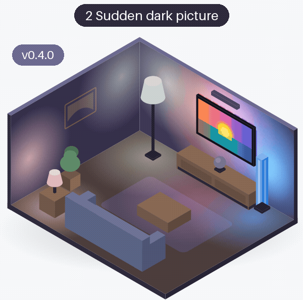
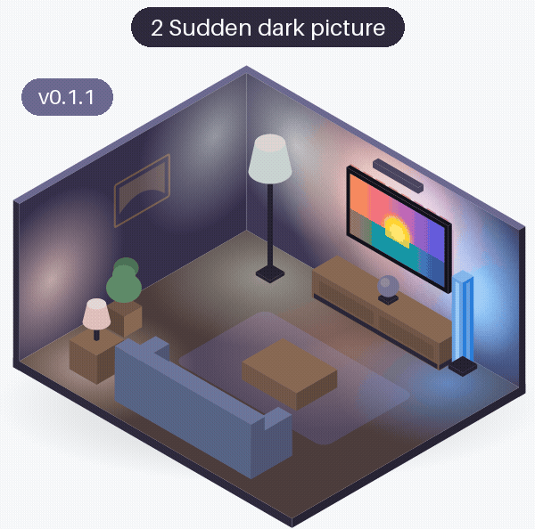
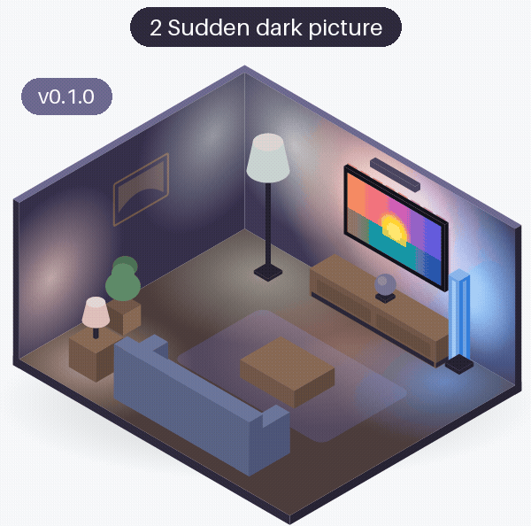
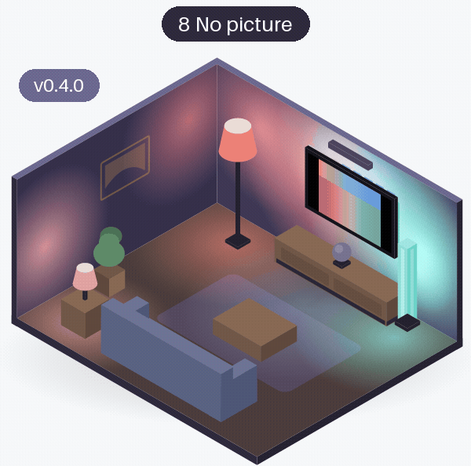
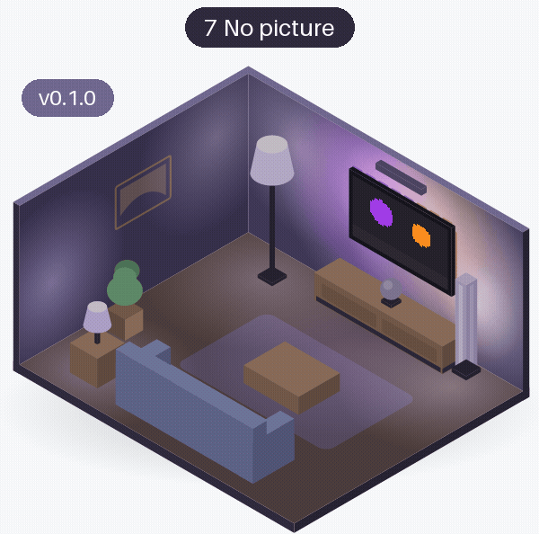

# Dark and no picture

What the lights do when the picture goes dark, and when there is no picture at all. A dark scene is often short, so the lights first hold their colours; a picture of only zeros (a streaming app with copy protection gives one) means there is nothing to follow, so Glowcast lets go. Each room is drawn from that release's own code (see [the room](index.md#the-room)); in a dark scenario the held colours are those of the scenario before it.

<!-- rooms -->
| Scenario | v0.4.0 | v0.3.1 | v0.3.0 | v0.2.0 | v0.1.1 | v0.1.0 |
|---|---|---|---|---|---|---|
| [2 Sudden dark picture](#area-sudden-dark-picture) | [{ width="140" loading=lazy }](rooms/v0.4.0/area-sudden-dark-picture.gif) [● changed](#area-sudden-dark-picture){ .glowcast-changed } | [same](rooms/v0.1.1/area-sudden-dark-picture.gif "same as v0.1.1") | [same](rooms/v0.1.1/area-sudden-dark-picture.gif "same as v0.1.1") | [same](rooms/v0.1.1/area-sudden-dark-picture.gif "same as v0.1.1") | [{ width="140" loading=lazy }](rooms/v0.1.1/area-sudden-dark-picture.gif) [● changed](#area-sudden-dark-picture){ .glowcast-changed } | [{ width="140" loading=lazy }](rooms/v0.1.0/area-sudden-dark-picture.gif) [new](#area-sudden-dark-picture) |
| [8 No picture](#area-no-picture) | [{ width="140" loading=lazy }](rooms/v0.4.0/area-no-picture.gif) [● changed](#area-no-picture){ .glowcast-changed } | [same](rooms/v0.2.0/area-no-picture.gif "same as v0.2.0") | [same](rooms/v0.2.0/area-no-picture.gif "same as v0.2.0") | [{ width="140" loading=lazy }](rooms/v0.2.0/area-no-picture.gif) [● changed](#area-no-picture){ .glowcast-changed } | [{ width="140" loading=lazy }](rooms/v0.1.1/area-no-picture.gif) [● changed](#area-no-picture){ .glowcast-changed } | [{ width="140" loading=lazy }](rooms/v0.1.0/area-no-picture.gif) [new](#area-no-picture) |

● changed: what the lights get changed since the previous release; new: the first release with these lights. Both show the GIF; click it to see it full size. same: the same as in the previous release (within rounding), a link to its GIF. -: not available.

### 2 Sudden dark picture { #area-sudden-dark-picture }

**The picture:** After the sunset, a sudden dark night scene: nearly black, but not all zero.

**What the lights should do:** Hold the last colours for a moment (a dark scene is often short), then fade to a faint warm glow instead of going dark.

=== "v0.4.0 ●"

    ● The held colours are the livelier ones of the sunset before it; the hold and the glow are as before.

    [{ width="400" loading=lazy }](rooms/v0.4.0/area-sudden-dark-picture.gif)

=== "v0.3.1"

    Same as v0.1.1. v0.3.1 changed what the room does not show; see [the overview](index.md#same-room-other-changes).

    [{ width="400" loading=lazy }](rooms/v0.1.1/area-sudden-dark-picture.gif)

=== "v0.3.0"

    Same as v0.1.1.

    [{ width="400" loading=lazy }](rooms/v0.1.1/area-sudden-dark-picture.gif)

=== "v0.2.0"

    Same as v0.1.1.

    [{ width="400" loading=lazy }](rooms/v0.1.1/area-sudden-dark-picture.gif)

=== "v0.1.1 ●"

    ● The glow is now only added to lights that show a dark part of the picture.

    [{ width="400" loading=lazy }](rooms/v0.1.1/area-sudden-dark-picture.gif)

=== "v0.1.0"

    The first release.

    [{ width="400" loading=lazy }](rooms/v0.1.0/area-sudden-dark-picture.gif)

### 8 No picture { #area-no-picture }

**The picture:** No picture at all: every pixel is zero, as the TV gives for a streaming app with copy protection.

**What the lights should do:** Hold the last colours, then the glow, and after 7 seconds without a picture let go of the lights, so they return to how they were before syncing (drawn off in the room).

=== "v0.4.0 ●"

    ● The held colours are the livelier ones of the 4:3 picture before it; letting go after 7 seconds is as before.

    [{ width="400" loading=lazy }](rooms/v0.4.0/area-no-picture.gif)

=== "v0.3.1"

    Same as v0.2.0. v0.3.1 changed what the room does not show; see [the overview](index.md#same-room-other-changes).

    [{ width="400" loading=lazy }](rooms/v0.2.0/area-no-picture.gif)

=== "v0.3.0"

    Same as v0.2.0.

    [{ width="400" loading=lazy }](rooms/v0.2.0/area-no-picture.gif)

=== "v0.2.0 ●"

    ● No picture, no light show: after 7 seconds of an all-zero picture Glowcast lets go of the lights.

    [{ width="400" loading=lazy }](rooms/v0.2.0/area-no-picture.gif)

=== "v0.1.1 ●"

    ● The glow is now only added to lights that show a dark part of the picture.

    [{ width="400" loading=lazy }](rooms/v0.1.1/area-no-picture.gif)

=== "v0.1.0"

    The first release: without a picture the lights keep the glow; Glowcast does not let go of them.

    [{ width="400" loading=lazy }](rooms/v0.1.0/area-no-picture.gif)

<!-- /rooms -->
