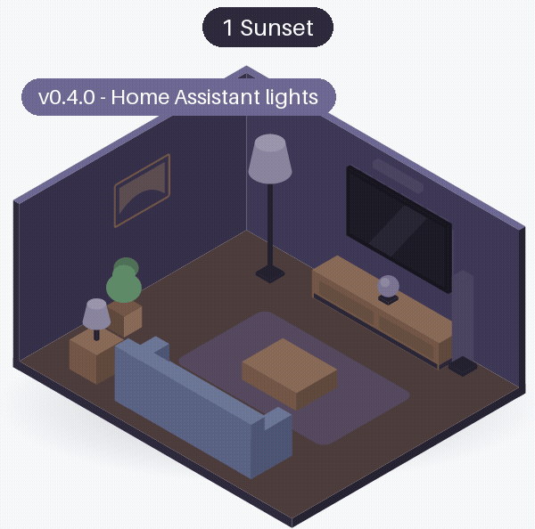
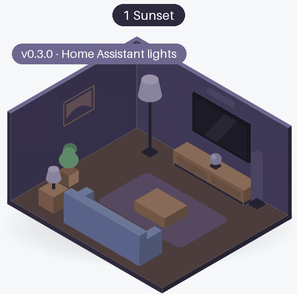
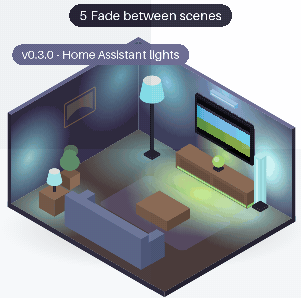
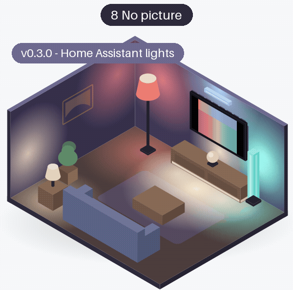
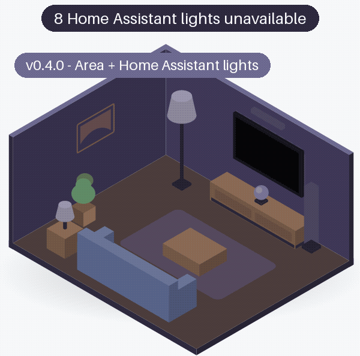
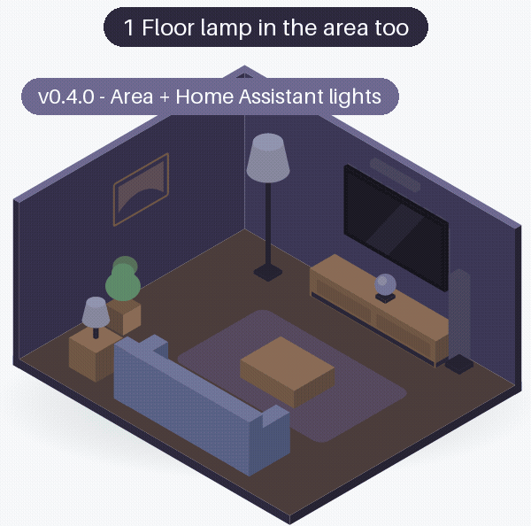
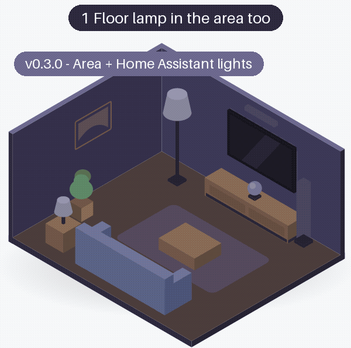

# Home Assistant lights

[Home Assistant lights](../docs/home-assistant-lights.md) are colour lights of any brand, each at its own place, driven through Home Assistant about once per second with a fade. They came in v0.3.0 (then called loose lights). The room has six of them: a floor lamp (left), a light bar (right), a wall light above the TV (top), an orb lamp and a light strip on the console (bottom) and a table lamp by the sofa (ambient). Each room is drawn from that release's own code (see [the room](index.md#the-room)).

<!-- rooms -->
| Scenario | v0.4.0 | v0.3.1 | v0.3.0 | v0.2.0 | v0.1.1 | v0.1.0 |
|---|---|---|---|---|---|---|
| [Home Assistant lights: 1 Sunset](#ha-sunset) | [{ width="140" loading=lazy }](rooms/v0.4.0/ha-sunset.gif) [● changed](#ha-sunset){ .glowcast-changed } | [same](rooms/v0.3.0/ha-sunset.gif "same as v0.3.0") | [{ width="140" loading=lazy }](rooms/v0.3.0/ha-sunset.gif) [new](#ha-sunset) | - | - | - |
| [Home Assistant lights: 5 Fade between scenes](#ha-fade-between-scenes) | [{ width="140" loading=lazy }](rooms/v0.4.0/ha-fade-between-scenes.gif) [● changed](#ha-fade-between-scenes){ .glowcast-changed } | [same](rooms/v0.3.0/ha-fade-between-scenes.gif "same as v0.3.0") | [{ width="140" loading=lazy }](rooms/v0.3.0/ha-fade-between-scenes.gif) [new](#ha-fade-between-scenes) | - | - | - |
| [Home Assistant lights: 8 No picture](#ha-no-picture) | [{ width="140" loading=lazy }](rooms/v0.4.0/ha-no-picture.gif) [● changed](#ha-no-picture){ .glowcast-changed } | [same](rooms/v0.3.0/ha-no-picture.gif "same as v0.3.0") | [{ width="140" loading=lazy }](rooms/v0.3.0/ha-no-picture.gif) [new](#ha-no-picture) | - | - | - |
| [Together: 9 Home Assistant lights unavailable](#combined-home-assistant-lights-unavailable) | [{ width="140" loading=lazy }](rooms/v0.4.0/combined-home-assistant-lights-unavailable.gif) [● changed](#combined-home-assistant-lights-unavailable){ .glowcast-changed } | [same](rooms/v0.3.0/combined-home-assistant-lights-unavailable.gif "same as v0.3.0") | [{ width="140" loading=lazy }](rooms/v0.3.0/combined-home-assistant-lights-unavailable.gif) [new](#combined-home-assistant-lights-unavailable) | - | - | - |
| [Together: 1 Floor lamp in the area too](#in-area-floor-lamp-in-the-area-too) | [{ width="140" loading=lazy }](rooms/v0.4.0/in-area-floor-lamp-in-the-area-too.gif) [● changed](#in-area-floor-lamp-in-the-area-too){ .glowcast-changed } | [{ width="140" loading=lazy }](rooms/v0.3.1/in-area-floor-lamp-in-the-area-too.gif) [● changed](#in-area-floor-lamp-in-the-area-too){ .glowcast-changed } | [{ width="140" loading=lazy }](rooms/v0.3.0/in-area-floor-lamp-in-the-area-too.gif) [new](#in-area-floor-lamp-in-the-area-too) | - | - | - |

● changed: what the lights get changed since the previous release; new: the first release with these lights. Both show the GIF; click it to see it full size. same: the same as in the previous release (within rounding), a link to its GIF. -: not available.

### Home Assistant lights: 1 Sunset { #ha-sunset }

**The picture:** The sunset, with six Home Assistant lights round the room, each at its own place: left, right, top, bottom (two) and ambient.

**What the lights should do:** Fade in from how they were to the colour of their own part of the picture, each about once per second with a smooth transition.

=== "v0.4.0 ●"

    ● Livelier colours, also for Home Assistant lights.

    [{ width="400" loading=lazy }](rooms/v0.4.0/ha-sunset.gif)

=== "v0.3.1"

    Same as v0.3.0. v0.3.1 also changed things the room does not show; see [the overview](index.md#same-room-other-changes).

    [{ width="400" loading=lazy }](rooms/v0.3.0/ha-sunset.gif)

=== "v0.3.0"

    Home Assistant lights (then called loose lights) are new in v0.3.0.

    [{ width="400" loading=lazy }](rooms/v0.3.0/ha-sunset.gif)

=== "v0.2.0"

    Not available: Home Assistant lights came in v0.3.0.

=== "v0.1.1"

    Not available: Home Assistant lights came in v0.3.0.

=== "v0.1.0"

    Not available: Home Assistant lights came in v0.3.0.

### Home Assistant lights: 5 Fade between scenes { #ha-fade-between-scenes }

**The picture:** The ocean fading into the meadow, with the six Home Assistant lights.

**What the lights should do:** Follow the fade from blue to green, a little behind the picture: Home Assistant lights change about once per second, with a fade.

=== "v0.4.0 ●"

    ● Livelier colours, also for Home Assistant lights.

    [{ width="400" loading=lazy }](rooms/v0.4.0/ha-fade-between-scenes.gif)

=== "v0.3.1"

    Same as v0.3.0. v0.3.1 also changed things the room does not show; see [the overview](index.md#same-room-other-changes).

    [{ width="400" loading=lazy }](rooms/v0.3.0/ha-fade-between-scenes.gif)

=== "v0.3.0"

    Home Assistant lights (then called loose lights) are new in v0.3.0.

    [{ width="400" loading=lazy }](rooms/v0.3.0/ha-fade-between-scenes.gif)

=== "v0.2.0"

    Not available: Home Assistant lights came in v0.3.0.

=== "v0.1.1"

    Not available: Home Assistant lights came in v0.3.0.

=== "v0.1.0"

    Not available: Home Assistant lights came in v0.3.0.

### Home Assistant lights: 8 No picture { #ha-no-picture }

**The picture:** No picture at all (all pixels zero), with the six Home Assistant lights.

**What the lights should do:** Hold, then let go after 7 seconds without a picture: the Home Assistant lights go back to how they were (drawn off in the room).

=== "v0.4.0 ●"

    ● The held colours are the livelier ones of the scenario before it; letting go is as before.

    [{ width="400" loading=lazy }](rooms/v0.4.0/ha-no-picture.gif)

=== "v0.3.1"

    Same as v0.3.0. v0.3.1 also changed things the room does not show; see [the overview](index.md#same-room-other-changes).

    [{ width="400" loading=lazy }](rooms/v0.3.0/ha-no-picture.gif)

=== "v0.3.0"

    Home Assistant lights (then called loose lights) are new in v0.3.0.

    [{ width="400" loading=lazy }](rooms/v0.3.0/ha-no-picture.gif)

=== "v0.2.0"

    Not available: Home Assistant lights came in v0.3.0.

=== "v0.1.1"

    Not available: Home Assistant lights came in v0.3.0.

=== "v0.1.0"

    Not available: Home Assistant lights came in v0.3.0.

### Together: 9 Home Assistant lights unavailable { #combined-home-assistant-lights-unavailable }

**The picture:** An entertainment area (the strip, the floor lamp, the light bar and the table lamp) and three Home Assistant lights together, on a slowly moving picture. The wall light becomes unavailable in Home Assistant after 1 second, the other two after 3 seconds.

**What the lights should do:** The entertainment area keeps following the picture. Glowcast notices the Home Assistant lights are gone, tries them once more after a few seconds, and then drops that part; the room names what is unavailable and dropped.

=== "v0.4.0 ●"

    ● Livelier colours in the entertainment area; how the unavailable lights are handled is as before.

    [{ width="400" loading=lazy }](rooms/v0.4.0/combined-home-assistant-lights-unavailable.gif)

=== "v0.3.1"

    Same as v0.3.0. v0.3.1 also changed things the room does not show; see [the overview](index.md#same-room-other-changes).

    [{ width="400" loading=lazy }](rooms/v0.3.0/combined-home-assistant-lights-unavailable.gif)

=== "v0.3.0"

    An entertainment area and Home Assistant lights together are new in v0.3.0.

    [{ width="400" loading=lazy }](rooms/v0.3.0/combined-home-assistant-lights-unavailable.gif)

=== "v0.2.0"

    Not available: An entertainment area and Home Assistant lights together came in v0.3.0.

=== "v0.1.1"

    Not available: An entertainment area and Home Assistant lights together came in v0.3.0.

=== "v0.1.0"

    Not available: An entertainment area and Home Assistant lights together came in v0.3.0.

### Together: 1 Floor lamp in the area too { #in-area-floor-lamp-in-the-area-too }

**The picture:** An entertainment area (the strip, the floor lamp, the light bar and the table lamp) and Home Assistant lights together, on slowly moving colours. The floor lamp is a Hue light in the entertainment area and is also one of the Home Assistant lights, at the place Right: as when a Home Assistant light is added to the entertainment area later, in the Hue app.

**What the lights should do:** The floor lamp follows the entertainment area only, in the colour of the left of the picture: Glowcast leaves it out of the Home Assistant lights, so it gets no light commands. The other lights follow as usual.

=== "v0.4.0 ●"

    ● Livelier colours; the floor lamp still follows the entertainment area only.

    [{ width="400" loading=lazy }](rooms/v0.4.0/in-area-floor-lamp-in-the-area-too.gif)

=== "v0.3.1 ●"

    ● No longer driven twice: Glowcast leaves the floor lamp out of the Home Assistant lights, so it follows the entertainment area only; the log and a repair issue name it.

    [{ width="400" loading=lazy }](rooms/v0.3.1/in-area-floor-lamp-in-the-area-too.gif)

=== "v0.3.0"

    Driven twice: the stream gives the floor lamp the left of the picture, light commands the right. The room draws its glow from the stream and the lamp itself in the colour of the light commands, and says so at the bottom.

    [{ width="400" loading=lazy }](rooms/v0.3.0/in-area-floor-lamp-in-the-area-too.gif)

=== "v0.2.0"

    Not available: An entertainment area and Home Assistant lights together came in v0.3.0.

=== "v0.1.1"

    Not available: An entertainment area and Home Assistant lights together came in v0.3.0.

=== "v0.1.0"

    Not available: An entertainment area and Home Assistant lights together came in v0.3.0.

<!-- /rooms -->
