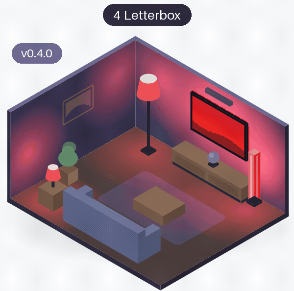
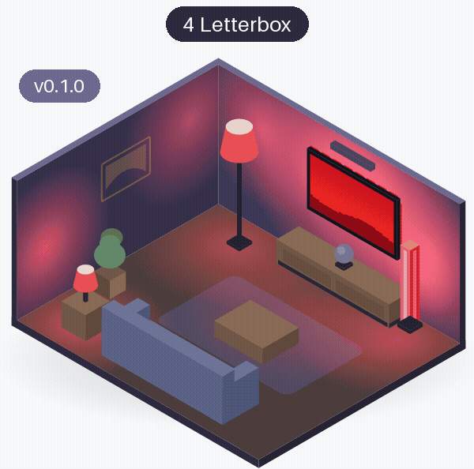
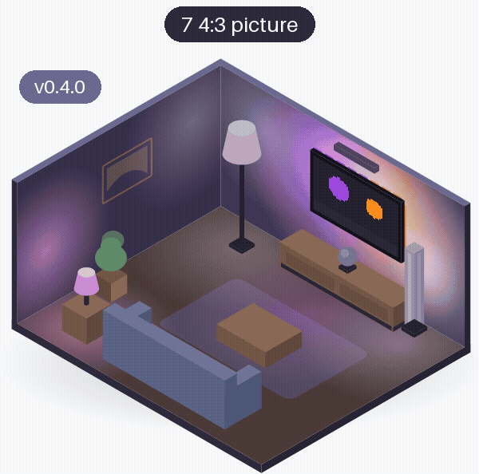
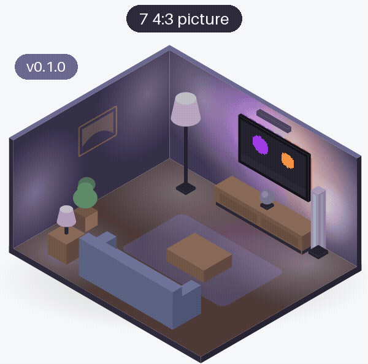
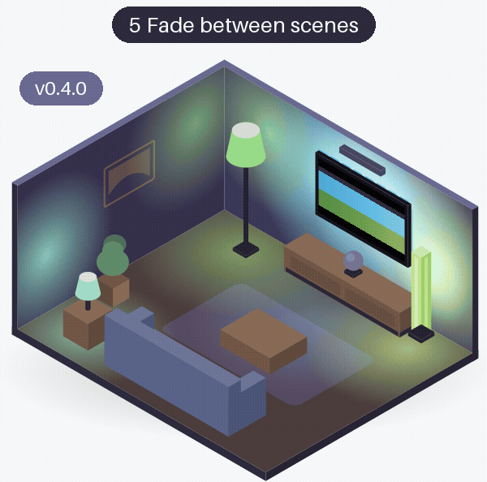
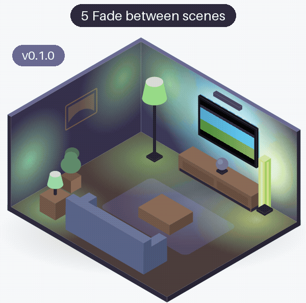

# Black bars and movement

Pictures that do not fill the screen, and pictures that move: a film with black bars above and below, an old 4:3 show with bars at the sides, and one scene fading into another. Each room is drawn from that release's own code (see [the room](index.md#the-room)). How the lights follow a scene cut shows at the start of [3 Saturated red](colours.md#area-saturated-red).

<!-- rooms -->
| Scenario | v0.5.1 | v0.5.0 | v0.4.0 | v0.3.1 | v0.3.0 | v0.2.0 | v0.1.1 | v0.1.0 |
|---|---|---|---|---|---|---|---|---|
| [4 Letterbox](#area-letterbox) | [same](rooms/v0.4.0/area-letterbox.gif "same as v0.4.0") | [same](rooms/v0.4.0/area-letterbox.gif "same as v0.4.0") | [{ width="140" loading=lazy }](rooms/v0.4.0/area-letterbox.gif) [● changed](#area-letterbox){ .glowcast-changed } | [same](rooms/v0.1.0/area-letterbox.gif "same as v0.1.0") | [same](rooms/v0.1.0/area-letterbox.gif "same as v0.1.0") | [same](rooms/v0.1.0/area-letterbox.gif "same as v0.1.0") | [same](rooms/v0.1.0/area-letterbox.gif "same as v0.1.0") | [{ width="140" loading=lazy }](rooms/v0.1.0/area-letterbox.gif) [new](#area-letterbox) |
| [7 4:3 picture](#area-43-picture) | [same](rooms/v0.4.0/area-43-picture.gif "same as v0.4.0") | [same](rooms/v0.4.0/area-43-picture.gif "same as v0.4.0") | [{ width="140" loading=lazy }](rooms/v0.4.0/area-43-picture.gif) [● changed](#area-43-picture){ .glowcast-changed } | [same](rooms/v0.1.0/area-43-picture.gif "same as v0.1.0") | [same](rooms/v0.1.0/area-43-picture.gif "same as v0.1.0") | [same](rooms/v0.1.0/area-43-picture.gif "same as v0.1.0") | [same](rooms/v0.1.0/area-43-picture.gif "same as v0.1.0") | [{ width="140" loading=lazy }](rooms/v0.1.0/area-43-picture.gif) [new](#area-43-picture) |
| [5 Fade between scenes](#area-fade-between-scenes) | [same](rooms/v0.4.0/area-fade-between-scenes.gif "same as v0.4.0") | [same](rooms/v0.4.0/area-fade-between-scenes.gif "same as v0.4.0") | [{ width="140" loading=lazy }](rooms/v0.4.0/area-fade-between-scenes.gif) [● changed](#area-fade-between-scenes){ .glowcast-changed } | [same](rooms/v0.1.0/area-fade-between-scenes.gif "same as v0.1.0") | [same](rooms/v0.1.0/area-fade-between-scenes.gif "same as v0.1.0") | [same](rooms/v0.1.0/area-fade-between-scenes.gif "same as v0.1.0") | [same](rooms/v0.1.0/area-fade-between-scenes.gif "same as v0.1.0") | [{ width="140" loading=lazy }](rooms/v0.1.0/area-fade-between-scenes.gif) [new](#area-fade-between-scenes) |

● changed: what the lights get changed since the previous release; new: the first release with these lights. Both show the GIF; click it to see it full size. same: the same as in the previous release (within rounding), a link to its GIF. -: not available.

### 4 Letterbox { #area-letterbox }

**The picture:** A film at dusk with black bars above and below the picture, and a dim band of sky just under the top bar.

**What the lights should do:** Take their colours from the picture between the bars, not from the bars, so the lights at the top do not turn grey.

=== "v0.5.1"

    Same as v0.4.0.

    [{ width="400" loading=lazy }](rooms/v0.4.0/area-letterbox.gif)

=== "v0.5.0"

    Same as v0.4.0.

    [{ width="400" loading=lazy }](rooms/v0.4.0/area-letterbox.gif)

=== "v0.4.0 ●"

    ● No grey lights from black bars: Glowcast finds the bars and takes every light's colour from the picture between them.

    [{ width="400" loading=lazy }](rooms/v0.4.0/area-letterbox.gif)

=== "v0.3.1"

    Same as v0.1.0. v0.3.1 also changed things the room does not show; see [the overview](index.md#same-room-other-changes).

    [{ width="400" loading=lazy }](rooms/v0.1.0/area-letterbox.gif)

=== "v0.3.0"

    Same as v0.1.0.

    [{ width="400" loading=lazy }](rooms/v0.1.0/area-letterbox.gif)

=== "v0.2.0"

    Same as v0.1.0.

    [{ width="400" loading=lazy }](rooms/v0.1.0/area-letterbox.gif)

=== "v0.1.1"

    Same as v0.1.0.

    [{ width="400" loading=lazy }](rooms/v0.1.0/area-letterbox.gif)

=== "v0.1.0"

    The first release: the lights at the top sample the black bar and the strip of picture under it.

    [{ width="400" loading=lazy }](rooms/v0.1.0/area-letterbox.gif)

### 7 4:3 picture { #area-43-picture }

**The picture:** An old 4:3 show in the wide screen: black bars on the left and the right, and in the picture a warm red wall on the left, a sky above and a teal wall on the right.

**What the lights should do:** Take the side lights' and the strip's colours from the picture's edges inside the bars: red on the left, teal on the right, not grey from the bars.

=== "v0.5.1"

    Same as v0.4.0.

    [{ width="400" loading=lazy }](rooms/v0.4.0/area-43-picture.gif)

=== "v0.5.0"

    Same as v0.4.0.

    [{ width="400" loading=lazy }](rooms/v0.4.0/area-43-picture.gif)

=== "v0.4.0 ●"

    ● Glowcast finds the bars at the sides too and takes the colours from the picture inside them: the strip's ends show the red and teal walls; with livelier colours, and the table lamp at the back follows more softly.

    [{ width="400" loading=lazy }](rooms/v0.4.0/area-43-picture.gif)

=== "v0.3.1"

    Same as v0.1.0. v0.3.1 also changed things the room does not show; see [the overview](index.md#same-room-other-changes).

    [{ width="400" loading=lazy }](rooms/v0.1.0/area-43-picture.gif)

=== "v0.3.0"

    Same as v0.1.0.

    [{ width="400" loading=lazy }](rooms/v0.1.0/area-43-picture.gif)

=== "v0.2.0"

    Same as v0.1.0.

    [{ width="400" loading=lazy }](rooms/v0.1.0/area-43-picture.gif)

=== "v0.1.1"

    Same as v0.1.0.

    [{ width="400" loading=lazy }](rooms/v0.1.0/area-43-picture.gif)

=== "v0.1.0"

    The first release: the lights at the sides sample the black bar together with the edge of the picture.

    [{ width="400" loading=lazy }](rooms/v0.1.0/area-43-picture.gif)

### 5 Fade between scenes { #area-fade-between-scenes }

**The picture:** A blue ocean scene that slowly fades into a green meadow.

**What the lights should do:** Follow the fade smoothly, from blue to green, without jumps.

=== "v0.5.1"

    Same as v0.4.0.

    [{ width="400" loading=lazy }](rooms/v0.4.0/area-fade-between-scenes.gif)

=== "v0.5.0"

    Same as v0.4.0.

    [{ width="400" loading=lazy }](rooms/v0.4.0/area-fade-between-scenes.gif)

=== "v0.4.0 ●"

    ● Livelier colours and the strip at the picture's edges; the fade itself stays smooth.

    [{ width="400" loading=lazy }](rooms/v0.4.0/area-fade-between-scenes.gif)

=== "v0.3.1"

    Same as v0.1.0. v0.3.1 also changed things the room does not show; see [the overview](index.md#same-room-other-changes).

    [{ width="400" loading=lazy }](rooms/v0.1.0/area-fade-between-scenes.gif)

=== "v0.3.0"

    Same as v0.1.0.

    [{ width="400" loading=lazy }](rooms/v0.1.0/area-fade-between-scenes.gif)

=== "v0.2.0"

    Same as v0.1.0.

    [{ width="400" loading=lazy }](rooms/v0.1.0/area-fade-between-scenes.gif)

=== "v0.1.1"

    Same as v0.1.0.

    [{ width="400" loading=lazy }](rooms/v0.1.0/area-fade-between-scenes.gif)

=== "v0.1.0"

    The first release.

    [{ width="400" loading=lazy }](rooms/v0.1.0/area-fade-between-scenes.gif)

<!-- /rooms -->
